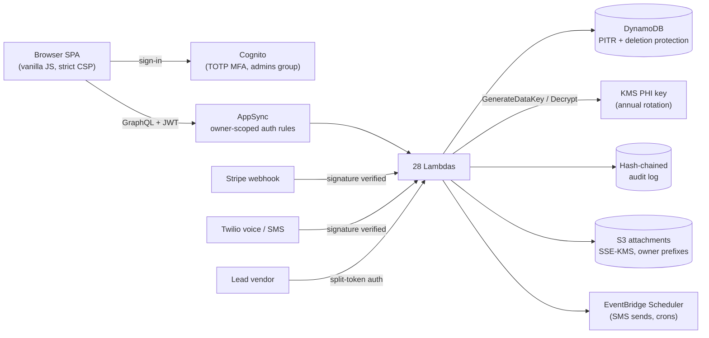

# The Arsenal — Engineering Showcase

**Selected components from The Arsenal, a production multi-tenant SaaS for life insurance agents that stores client health and financial data.**

The full platform is closed-source because it holds regulated client data and proprietary carrier underwriting rules. This repo shows the parts that matter most to an engineering reviewer: the security controls protecting that data, and the AI agent team that builds and tests the platform. Everything here is lifted from the production codebase, not rewritten for show.

**Built by [Jude Wakim](https://github.com/Judewakim)** — cloud security engineer, sole developer.

---

## The platform at a glance

| | |
|---|---|
| Codebase | ~175,000 lines (TypeScript backend, vanilla-JS frontend, tests, tooling) |
| History | 564 commits since May 2026 |
| Tests | 7,587 passing assertions across 123 suites, no test framework |
| Backend | 28 Lambda functions, 40 data models + 3 hand-built DynamoDB tables |
| Stack | AWS Amplify Gen 2 · AppSync (GraphQL) · DynamoDB · Lambda · Cognito · KMS · S3 · EventBridge Scheduler · CDK |
| Integrations | Stripe · Twilio (voice + SMS) · Google Calendar · Calendly · Slack · lead-vendor webhooks |



---

## What's in this repo

### 1. Security engineering — `amplify/`

| File | What it does |
|---|---|
| [`shared/field-crypto.ts`](amplify/shared/field-crypto.ts) | **Field-level envelope encryption.** One KMS data key per record, AES-256-GCM per field, plaintext key zeroed after use. Covers SSN, banking, DOB and the full health screen. The comments document a staged, no-data-loss removal of card fields: stop writing, purge, then forget how to read. |
| [`shared/audit-chain.ts`](amplify/shared/audit-chain.ts) | **Tamper-evident audit log.** Every record change appends to a per-owner hash chain inside a single DynamoDB transaction, so concurrent writes can't fork the chain. The verifier separates historical breaks from new ones. |
| [`shared/ownership.ts`](amplify/shared/ownership.ts) | **Tenant isolation guard.** `sameOwner()` refuses whenever either owner is missing or empty, closing the `undefined === undefined` bypass. |
| [`shared/twilio-signature.ts`](amplify/shared/twilio-signature.ts) | **Webhook verification that owns the parsing.** The handler can only act on the exact request whose signature was checked, so there is no parse-differential gap. |
| [`shared/ingest-token.ts`](amplify/shared/ingest-token.ts) | **Selector/secret credentials** for a public webhook: only a SHA-256 hash is stored, compared in constant time. |
| [`shared/log.ts`](amplify/shared/log.ts) | Log shaping that never prints request bodies, paths or secrets — enforced by tests that scan every handler. |
| [`shared/secrets.ts`](amplify/shared/secrets.ts) | Catches Amplify's unresolved secret placeholder reaching runtime instead of the real value. |
| [`cdk/service-source-condition.ts`](amplify/cdk/service-source-condition.ts) | **IAM confused-deputy hardening.** A CDK Aspect that pins every service role's trust policy to this account and service. Covers ~124 roles automatically, including ones CDK emits as raw resources. Proven safe by experiment in a sandbox account before rollout. |
| [`functions/voice-incoming/handler.ts`](amplify/functions/voice-incoming/handler.ts) | A public Twilio webhook built on the signature module. |

### 2. Tests — `test/`

269 assertions run here, offline, in a few seconds:

```bash
npm install
npm test          # 269 passed
npx tsc -p tsconfig.json
```

Tests are written from the attacker's side: forged signatures, flipped ciphertext bits, wrong keys, empty owners, and handlers that log what they shouldn't. `field-crypto.cases.mjs` was written for this repo (KMS is faked in memory); the rest are the production suites unchanged.

### 3. The AI engineering team — `.claude/` and `tools/`

The Arsenal is built by a team of Claude Code agents with me as architect, reviewer and approver.

- **[`.claude/agents/`](.claude/agents/)** — 10 role definitions: orchestrator, backend, frontend, tester, devops, docs-writer, reporter, plus security, UX and content specialists. Only the tester can close a ticket; nothing reaches `main` without a human.
- **[`.claude/skills/`](.claude/skills/)** — a security-engineering skill (OWASP Top 10:2025 / ASVS 5.0 framing, attacker-first review) and a git-worktree skill so agents work in parallel without colliding.
- **[`docs/ROUTINES.md`](docs/ROUTINES.md)** — the move from a local runner to server-side scheduled routines driven by GitHub Issues: ticket-worker, tester, Slack-intake and CI-health loops, with model choice by difficulty.
- **[`docs/CLAUDE.md`](docs/CLAUDE.md)** — the rules every agent inherits. Each hard rule records the production incident that created it.
- **[`tools/`](tools/)** — the task board, worktree manager, board sweep (catches tickets marked done that never shipped), orphan-import and stack-cycle checks, secret checks and deletion-protection tooling.

---

## Not included

The underwriting engine and carrier rules, sales scripts, pricing, internal security assessments, client data, and the rest of the application. References to those files in the docs above are left as-is.

## License

Copyright © 2026 Wakim Works. All rights reserved.
This code is published for viewing and evaluation only. No license is granted to copy, modify, or distribute it. See [LICENSE](LICENSE).
